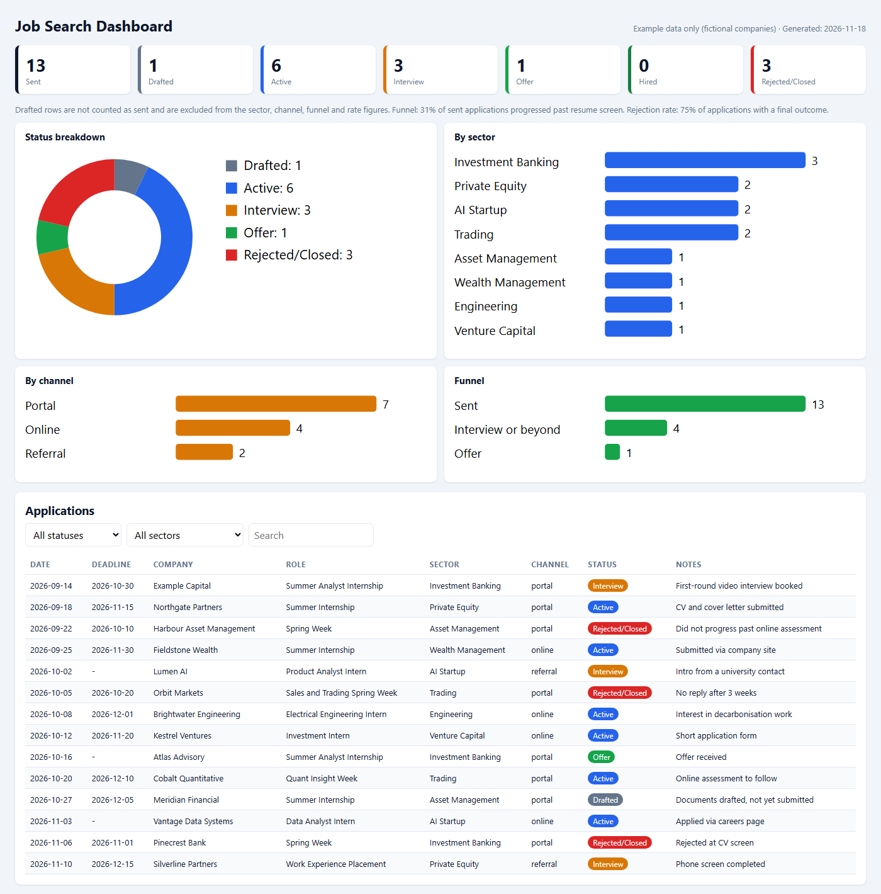

# Claude Code Job Search Workflow

My setup of an AI-assisted job application workflow, run locally with [Claude Code](https://claude.com/claude-code). I use it to find internships, check fit against my profile, tailor LaTeX CVs and keep track of applications.

> **Credit, up front.** The framework is **not my work**. It is the open-source [`MadsLorentzen/ai-job-search`](https://github.com/MadsLorentzen/ai-job-search) project by Mads Lorentzen (MIT licence). I am an engineering student, not a software engineer. I set it up, filled in and tuned it for my own search, and learned how it works by using it. This repository documents that setup. It contains no code from my personal workspace and none of my personal data.

## What the workflow does

```
/setup           /scrape / /rank          /apply <posting>
  |                   |                        |
Build a profile   Search job portals,      Evaluate fit against the profile,
from CV or        dedupe, score and        draft a tailored CV + cover letter,
an interview      rank the matches         have a second agent review, revise
                                                |
                                      /outcome, /interview, /notion-sync
                                      Track results, prep interviews, mirror
                                      the pipeline into Notion
```

The ideas I found most useful:

- **Fit before drafting.** Every posting is scored against a written profile first (skills, experience, behaviour), so effort goes on roles worth applying for.
- **A profile that is the single source of truth.** Claims in a CV or letter must trace back to it. A writing-style guide (no clichés, no unverified company claims) and a verification checklist sit on top.
- **Drafter and reviewer agents.** A second agent critiques the draft before I see it.
- **Compile and inspect.** Documents are built to PDF and checked for page count and layout, not just "looks fine in the source".
- **Untrusted input.** Job postings are treated as data, never as instructions.

## What I changed for my own use

- Wrote my profile, behavioural notes and target sectors for UK summer internships and spring weeks (finance, small AI companies, engineering). *This profile is private and is not in this repo.*
- Registered my own one-page CV and cover letter layouts with `/add-template`. The anonymised skeletons are in [`examples/templates`](examples/templates).
- Pointed the search at UK-relevant sources and tracked applications in a CSV, mirrored to Notion with `/notion-sync`.
- Used Git to version my own changes, kept strictly local so personal data never leaves my machine.

## Dashboard

The `/html-report` command turns the application tracker into an offline dashboard: status counts, charts by status, sector and channel, a funnel, and a filterable table. The screenshot below uses **fictional example data**, not my real applications, in the same layout.



The page itself is in [`examples/dashboard`](examples/dashboard/example-dashboard.html); download it and open it in a browser.

## Examples (fictional)

- [`examples/example_profile.md`](examples/example_profile.md): the shape of a profile file, with an invented candidate.
- [`examples/example_fit_evaluation.md`](examples/example_fit_evaluation.md): what a fit assessment looks like before any drafting.
- [`examples/templates`](examples/templates): placeholder CV and cover letter LaTeX templates (compile with `lualatex`).

## Privacy approach

The upstream project writes personal data into tracked files, so a public fork would expose it. I keep my working copy private and local, and publish only this separate repo of documentation and anonymised examples. If you use the framework, do the same.

## Run it yourself

Go to the upstream repository and follow its quick start. You need Claude Code, Python 3.10+, Bun, and a LaTeX distribution.

## Licence

My original text and examples here are MIT-licensed (see [LICENSE](LICENSE)). The upstream framework is MIT-licensed by its author and is not included here.
